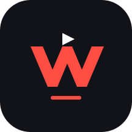

# SportsWave 2



Native Android sports discovery, calendar, and internal video player. Kotlin, native Android views, and AndroidX Media3. Android 8.0+; no companion player required.

## Build

Open the repository in Android Studio, set the SDK directory in ignored `local.properties`, and run:

```powershell
.\gradlew.bat :app:assembleDebug :app:testDebugUnitTest
```

Install `app/build/outputs/apk/debug/app-debug.apk`. The application package is `com.sportswave.app`, separate from the investigated apps.

Download the signed preview APK from this repository?s GitHub Releases. Preview builds include public playback samples; live broadcast sessions are not bundled.

## Verification

The [22 October original-app comparison](docs/BEIN-ORIGINAL-APP.md) distinguishes individual Yacine UI observations from SportsWave's 95-entry native decoder audit. SportsWave rendered video on 47 entries in that snapshot. Version 1.0.7 adds bounded session recovery for failed CDN redirects, connection failures and timeouts. Signed-APK UI checks also verified beIN Sports 1 and 8 playback; upstream failures remain.

The complete 675-record delivery audit and 36 verified public replacements are documented in [docs/CHANNEL-AUDIT.md](docs/CHANNEL-AUDIT.md), with a per-channel CSV. This audit does not establish that every catalog channel plays: 465 failed records still lack a verified replacement after the new alternatives and existing Alkass resolver are accounted for.

The [focused beIN follow-up](docs/BEIN-INVESTIGATION.md) records all 80 sports-quality entries and independent candidate checks. Numbered MENA feeds played intermittently and returned empty upstream pools again. Version 1.0.6 adds the independently verified English US **beIN SPORTS XTRA** feed as its own channel, visible before the provider catalog. It has different programming and does not substitute for MENA broadcasts.

The build and twenty-three JVM tests pass. Signed v1.0.4 emulator checks loaded 675 channel records across 32 packages and rendered Alkass 1?4 inside SportsWave. Alkass 5?8 were marked locked/premium; not every upstream channel is playable. Signed-release checks on a fresh Android 15 emulator verified beIN SPORTS 1 video without companion apps and live ATP tennis set-score updates across automatic refresh. Some other provider channels returned delivery errors. The emulator instrumentation checks catalog/calendar import, rejection of invalid calendars without partial source changes, duplicate-ID updates, broadcast reference matching, resolver configuration, deletion, and persistent favorites. Tests use a separate preferences file. A temporary beIN session rendered video during local testing, with intermittent buffering. That expiring session is not distributed.

```powershell
.\gradlew.bat :app:assembleDebug :app:testDebugUnitTest :app:assembleDebugAndroidTest
adb install -r app/build/outputs/apk/debug/app-debug.apk
adb install -r app/build/outputs/apk/androidTest/debug/app-debug-androidTest.apk
adb shell am instrument -w com.sportswave.app.test/com.sportswave.app.tests.CatalogInstrumentation
python scripts/smoke_android.py
```

The UI smoke script defaults to `emulator-5556`; set `SPORTSWAVE_DEVICE` for another device. It exercises discovery, schedule, favorites, internal HLS/DASH playback, and landscape fullscreen. It needs network access to the public samples. Screenshots and logs are written to `artifacts/`.

## Included behavior

- Discover, Schedule, Live, Channels, and Saved navigation with consistent drawn icons.
- Public ESPN scoreboards (all football, Champions League, Premier League, LaLiga, Ligue 1, Serie A, NBA, NFL, ATP/WTA tennis), OpenLigaDB Bundesliga fixtures, and PNG/SVG team crests; refreshes every 30 seconds on the Live screen.
- Tennis player names/country flags, set-by-set scores, and provider-supplied live set status. Nested tournament matches and doubles names are supported; no match clock is invented.
- OpenF1 latest session classification with driver order, team, gap, and lap count. Public results only; live timing is not connected.
- Complete recursive Yacine catalog browsing (675 records / 32 leaf packages observed), sports-first ordering, global search, package filtering and cached identities/logos. Quality variants share a row and remain selectable in the player, with bounded same-channel fallback on delivery errors.
- Fresh official public Alkass 1?4 HLS resolution, verified in the signed release. Locked/premium records remain subject to provider access. Direct backend resolution runs on each player opening and Retry; no companion player is needed.
- Included Red Bull TV HLS live channel, verified inside the player on 21 October 2026. Availability can vary by region.
- Sport filters covering football, basketball, tennis, motorsport, rugby, handball, volleyball, American football, padel, cricket, combat, cycling, athletics, swimming, golf, and other sports.
- Local-time dates, event search, event details, and persistent favorites.
- Direct HTTPS source entry, source removal, and JSON catalog/calendar import through Android's file picker.
- Internal HLS, DASH, and progressive playback; buffering, pause/seek, retry, quality cap, speed, fit/fill, fullscreen, and optional Widevine configuration.
- Provider-neutral HTTPS resolver support for fetching fresh playback sessions rather than hardcoding expiring URLs.

The default calendar combines the official beIN MENA live-program guide, Yacine's published event/channel assignments, imported events, and public fixtures for the selected date. Dates use the device timezone. Live-program listings are schedule metadata, not proof that the upstream video feed is working. Broadcast assignments remain scoped to their published provider and channel; beIN US never substitutes for a MENA broadcast. Events without a published assignment stay unlinked. The illustrative calendar and public player samples remain separate.

## Add real sources and events

Use Channels → Add source for a direct HTTPS media URL, or import a JSON array of sources. Import a JSON object with `sources` and `events` for a combined catalog. See `examples/catalog.json` for a usable sample. Sample event dates are fixed, not automatically rolled forward.

Source fields: `id`, `name`, `sport`, `url`, optional `mime`, `userAgent`, `headers`, `licenseUrl`, `licenseHeaders`, `resolverUrl`, `resolverHeaders`, `provider`, `channelId`, and `aliases`. Supply a direct `url` or a `resolverUrl`. Native Yacine descriptors instead use `integration: "yacine"`, a numeric `channelId`, and `serviceUrl`; the catalog cache contains no resolved media URL. Optional `logoUrl` supplies provider imagery. License configuration is Widevine; other schemes are not implemented. HTTPS is the default. A catalog source may explicitly set `allowHttp: true` for an HTTP media source; resolver and license endpoints still require HTTPS. Android permits HTTP transport for these opted-in media sources; TLS certificate validation remains enabled for HTTPS. Source settings live in application-private preferences, excluded from Android backup. Prefer a resolver to persisting short-lived credentials on the device.

Event fields: `id`, `sport`, `competition`, `home`, `away`, `startUtc` (ISO-8601 UTC timestamp), optional `endUtc` and `sourceId`. `sourceId` links a calendar event to a source. Imported calendars replace the previous imported events; imported sources merge by ID. Favorites remain stored separately. Search applies on the keyboard Search action.

## Calendar-to-broadcast routing

Events may also include `broadcasts`, an ordered array of references using `provider` and `channelId`, `provider` and `channelName`, or an explicit `sourceId`. Provider names need to agree with the source catalog, rather than referring to its distributor: use `provider: "beIN"` or `provider: "Alkass"`, even when both were found through Yacine.

```json
{
  "broadcasts": [
    {"provider": "beIN", "channelName": "beIN SPORTS 1"},
    {"provider": "Alkass", "channelName": "Alkass 1"}
  ]
}
```

The importer validates every broadcast reference before saving the catalog and calendar together. Matching uses exact source IDs first, then channel IDs scoped by provider, or exact normalized names/aliases. Quality suffixes are ignored, but channel numbers are preserved: channel 1 never matches channel 11. It never guesses a channel from a sport or competition. A source's `sport: "Multi-sport"` keeps it visible across sport filters.

Tapping a mapped event during its published broadcast window opens its assigned channel inside SportsWave and requests a fresh playback session. Upcoming and ended events open details instead. This works for team matches, individual sports, races, and sessions. Long-press an event for details and other broadcasts. The player offers **Choose another broadcast** when alternatives exist; quality variants stay within the assigned channels. Provider outages can still prevent playback.

Public scoreboards inherit a published broadcast only when both participant identities, sport, and start time match a calendar entry. No channel is guessed from competition or sport. Saved events retain their schedule and broadcast references when changing dates. Fullscreen fills the landscape window, hides system bars, and retains the existing player and playback position; Back first returns to portrait playback.

See `examples/multi-provider-calendar.json` for a working public-video routing demonstration using two clearly named sample providers.

## Resolver contract

Configure a source with your provider's HTTPS `resolverUrl`. SportsWave performs a GET on each player opening and retry, applies `resolverHeaders` to that request only, and expects a plain JSON object:

```json
{
  "url": "https://your-provider.example/session/manifest.m3u8",
  "mime": "application/x-mpegURL",
  "userAgent": "SportsWave/1.0",
  "headers": {},
  "licenseUrl": "",
  "licenseHeaders": {}
}
```

`url` is required. Supply stream-specific headers, not credentials intended only for the resolver. The response remains in memory. Playback headers and license headers are configured separately. The client does not log full stream URLs. Retry fetches the current session. The native Yacine integration also attempts one recovery on an expired authorization response, HTTP 503, or a lost live window; generic resolvers require manual Retry. Headers applied to media requests must be scoped appropriately by the provider, particularly if its delivery redirects across hosts.

The Yacine integration reads the provider's encoded responses using a small Kotlin implementation of the inspected response transformation. It calls the channel endpoint for the current playback record and forwards its media URL, user agent, and headers to Media3. It does not bundle the original app, native libraries, captured sessions, or media delivery URLs. This is an unofficial integration and depends on provider availability. The beIN website remains a guide reference, not a streaming API.

## References and assets

- ESPN public scoreboard example: https://site.api.espn.com/apis/site/v2/sports/soccer/uefa.champions/scoreboard
- OpenLigaDB: https://github.com/OpenLigaDB/OpenLigaDB-Samples
- OpenF1: https://openf1.org/docs/ (public session results; real-time data requires subscription)
- AndroidSVG: https://bigbadaboom.github.io/androidsvg/ (Apache 2.0, team crest rendering)
- Red Bull live events: https://www.redbull.com/us-en/live-events
- Media3: https://developer.android.com/media/media3/exoplayer/hello-world
- beIN MENA guide: https://www.beinsports.com/en-mena/tv-guide
- beIN France guide: https://www.beinsports.com/fr-fr/tv-guide
- HLS sample: https://test-streams.mux.dev/
- DASH sample: https://storage.googleapis.com/shaka-demo-assets/angel-one/dash.mpd
- Bundled sports photography: Unsplash image IDs `photo-1522778119026-d647f0596c20`, `photo-1546519638-68e109498ffc`, `photo-1554068865-24cecd4e34b8`. These are illustrative editorial images, not fixture imagery. Racing uses an original vector illustration.

This first version is an Android app, not a website or Android TV client. Arabic translations, push notifications, authentication, automated live calendar ingestion, casting, downloads, background playback, and billing are outside the implemented scope.

## Signed release builds

Set `SPORTSWAVE_KEYSTORE`, `SPORTSWAVE_STORE_PASSWORD`, and `SPORTSWAVE_KEY_PASSWORD` in your build environment, using a private keystore with alias `sportswave`. Run `./gradlew :app:assembleRelease`. Keep the keystore and credentials outside this repository; future updates must use the same signing key.

The original launcher artwork is a coral wave monogram with a white play accent, including adaptive and monochrome Android icons.
